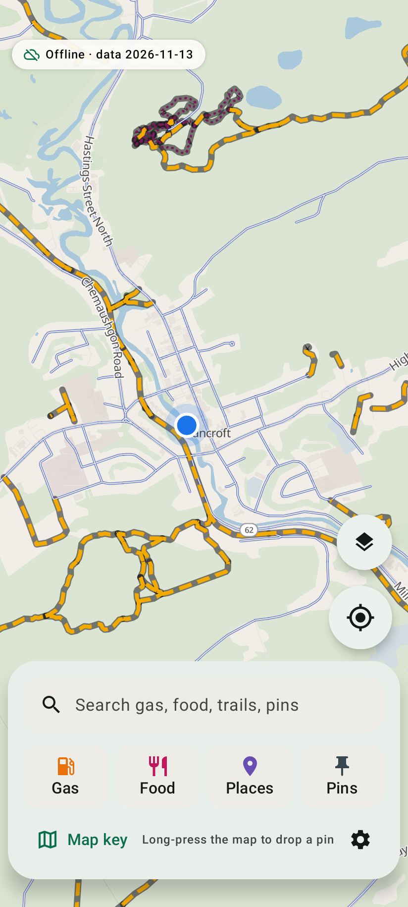
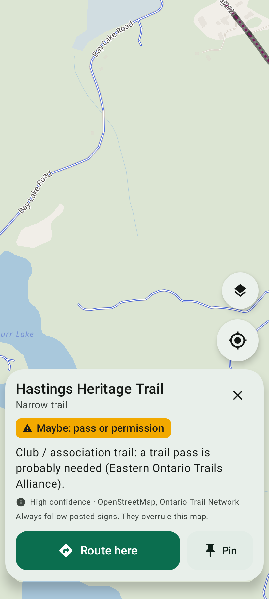
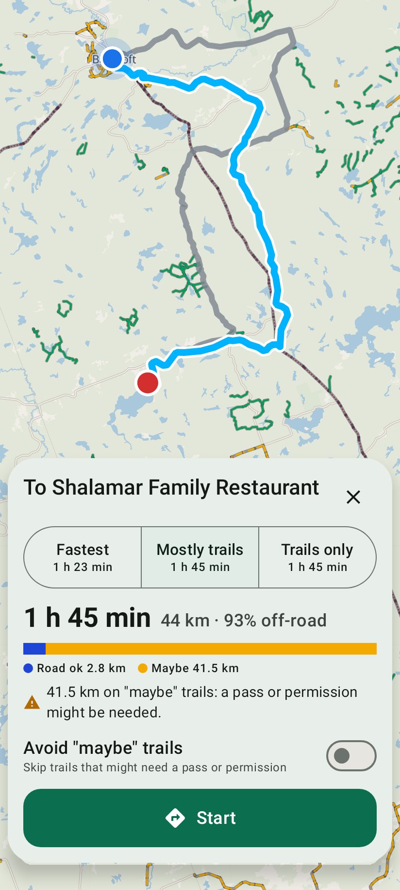
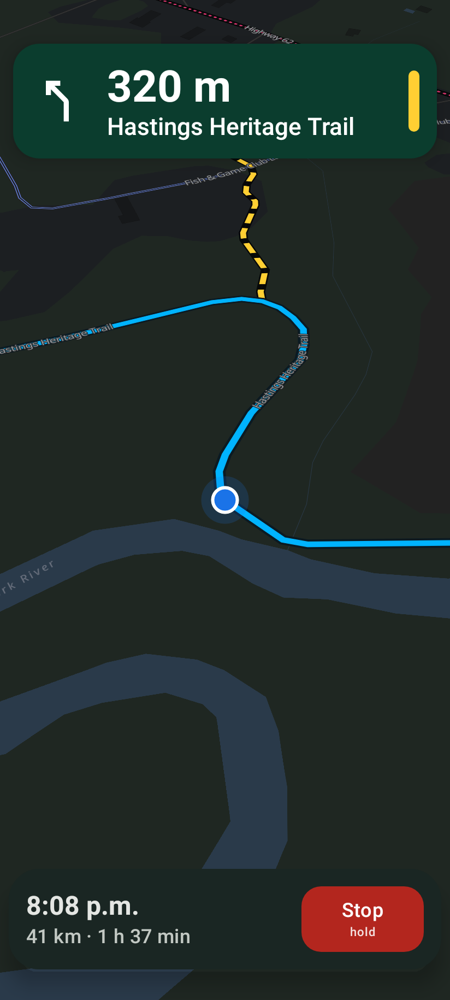

# Bancroft Trails: free offline ATV map & router

An Android app (built for the Pixel 11 Pro, works on any Android 12+ phone) for riding a regular ATV
within **100 km of Bancroft, Ontario**. No account, no subscription, **no signal needed**: the map,
every trail, gas/food/places and the router are all inside the app.

| Browse | Trail info | Route options | Navigating |
|---|---|---|---|
|  |  |  |  |

## What it does
- **Colour-coded trails**:
  - 🟢 free (Crown land trails / forest roads)
  - 🔵 road where ATVs are allowed
  - 🟡 *maybe*: club pass, private land, restricted, or rules unconfirmed
  - ⚫ no ATVs: parks, closed highways, hiking trails

  Tap any trail to see *why* it has that colour and which sources agree.
- **Routing** over trails *and* roads with three modes: **Fastest**, **Mostly trails**, **Trails only**,
  plus **Avoid "maybe" trails**. It shows time, km, % off-road and a breakdown by trail class, with warnings for
  gates, pass-needed trails or unavoidable no-ATV stretches.
- **Turn-by-turn** with voice and vibration, re-routes when you leave the route, keeps the screen on while
  riding, and needs a 1-second hold to stop, so a bump can't cancel it.
- **Gas, food, places to see** (lookouts, waterfalls, campgrounds, parking, gates), with a "nearby" list.
- **Your own pins**: parking, good trail, blocked (routes avoid it), food stop, notes. Saved on the phone.
- Light / dark / auto theme. Big controls in thumb reach, usable with gloves.

## Install on your phone
1. Download `BancroftTrails.apk` (from the PR / release, or build it below) onto the phone.
2. Open it; Android asks to allow installs from that app (Files / Chrome): allow it once.
3. Open **Bancroft Trails**, allow location. Done. It works in airplane mode.

## How the trail status is decided (cross-referenced sources)
| Source | Licence | Used for |
|---|---|---|
| OpenStreetMap (via Protomaps basemap, 2026-11-13) | ODbL | roads, tracks, trails, gas, food, POIs |
| Ontario MNRF Road Segments | OGL-Ontario | forest access roads: Crown/private, open/restricted/closed |
| MNR Road Barriers | OGL-Ontario | gates, berms, boulders |
| Crown Land (MNR Unpatented Land) | OGL-Ontario | Crown vs private land |
| Provincial Parks & Conservation Reserves | OGL-Ontario | no-ORV zones |
| Ontario Trail Network segments | OGL-Ontario | club / multi-use trails and their permitted uses |
| Ontario Road Network | OGL-Ontario | cross-check of public roads |
| Township ORV by-laws, O. Reg. 316/03 & 8/03 | research notes ([rules](pipeline/rules/orv_rules.json)) | where ATVs may ride on roads |

Each segment gets a confidence (how many independent sources agree). Club systems (EOTA, OFATV clubs, HATVA…)
are flagged **maybe**. **OFSC snowmobile trails are never ATV trails.** Websites like EOTA, QuadON, Trailforks, onX,
Gaia and Backroad Mapbooks were used only to check results; their data isn't copied ([survey](docs/sources_survey.md)).

> ⚠️ This is a best guess from public data, not legal advice. Posted signs, gates and landowners always win.
> Many township road rules could only be confirmed from summaries; they're marked low-confidence in the app.

## Project layout
```
pipeline/            data build (Python + Node)
  fetch_lio.py         download Ontario open data for the region
  build_data.py        stitch OSM + LIO into a routable graph, classify every segment
  style/gen_style.mjs  map styles (light/dark) + trail layers
  make_assets.sh       run everything → android/app/src/main/assets
android/             Kotlin + Jetpack Compose + MapLibre Native app
docs/                research: sources survey, design brief, screenshots
```

## Rebuild
```bash
# data (needs python3: shapely mapbox-vector-tile pmtiles; go-pmtiles; tippecanoe; node)
trail-app/pipeline/make_assets.sh /tmp/trailwork
# app
cd trail-app/android && ./gradlew assembleRelease        # → app/build/outputs/apk/release/app-release.apk
./gradlew testDebugUnitTest                               # routing tests + UI screenshots (build/screenshots)
```
Builds are signed with `android/keystore/sideload.jks` so new versions install over old ones (keeps your pins).
That key is only for sideloading; make a private key before ever publishing to the Play Store.

## Known limits / next ideas
- OSM `atv=*` / `snowmobile=*` tags aren't in the basemap extract; with direct OSM access (Overpass) the
  classifier could use them. The network here blocked Overpass/Geofabrik.
- Later: ride recording (GPX), fuel-range warnings, updating data from inside the app.
